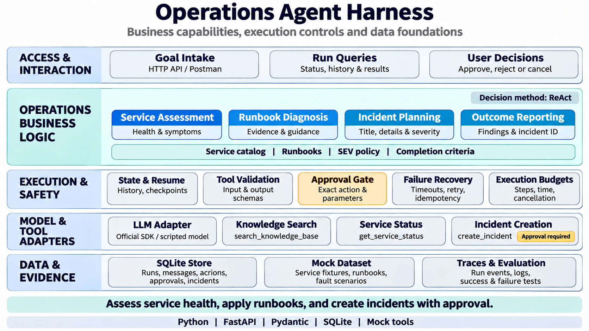
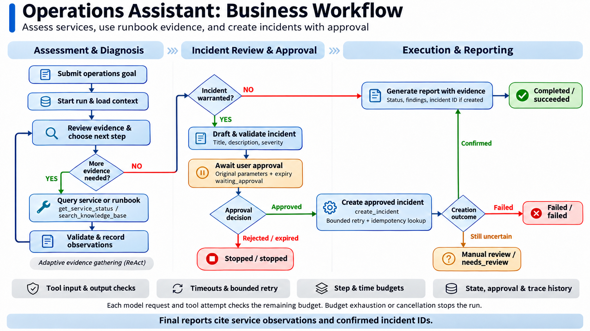

# Operations Agent Harness: Architecture and Business Workflow

Date: 2026-11-12

## Layered Architecture

The assistant assesses service health, applies runbook guidance, proposes incident details, and reports findings supported by tool evidence. Its responsibilities are organized into five layers.

| Layer | Responsibility |
| --- | --- |
| Access & Interaction | Accept goals, expose run status and history, and receive user approval or cancellation. |
| Operations Business Logic | Assess services, diagnose with runbooks, plan incidents, and produce reports. Service catalogs, SEV policy, and completion criteria provide business context. |
| Execution & Safety | Manage resumable state, validate tool contracts, enforce approval, recover from transient failures, and apply execution budgets. |
| Model & Tool Adapters | Connect an official model SDK or scripted model to three registered mock tools. Incident creation requires approval for the exact action and parameters. |
| Data & Evidence | Persist run state and incident results in SQLite, provide deterministic mock scenarios, and retain traces and test evidence. |

ReAct supports evidence gathering and decision updates within business logic. The architecture separates domain capabilities, execution policy, integrations, and persistent evidence.

## Business Workflow

1. Receive a goal and load the relevant service context.
2. Review available evidence. Query service status or runbooks when additional information is needed, validate the results, and update the assessment.
3. Decide whether the evidence warrants an incident. Findings can also lead directly to a report.
4. Draft and validate the title, description, and severity. Save the original parameters and wait for user approval.
5. Create an approved incident with bounded retries and a stable idempotency key. Confirm the outcome before reporting an incident ID.
6. Return a report supported by service observations and confirmed incident results. Record failed, stopped, or unresolved outcomes explicitly.

Every model request and tool attempt checks the remaining budget. Retries consume the original budget, and approval waits retain their expiry. Tool activity, state changes, approvals, and stop reasons are linked through the run ID.

## Implementation Approach

- Implemented with Python 3.12, FastAPI and Pydantic following the supplied framework specification. Model decisions, tool schemas, business policies, state transitions and event contracts are defined explicitly.
- Build the control loop with a scripted model and deterministic mock tools, then exercise approval, failure, recovery, and budget paths.
- Add SQLite persistence and HTTP endpoints, including approval recovery and repeat-request handling.
- Connect one real model provider and deliver Postman examples, automated tests, representative traces, and the versioned mock dataset.

## Image Generation Record

The two English images were produced with the built-in image generation tool. Full prompts and the workflow copy edit are recorded in [English image prompts](./image-generation-prompts-en.md).
