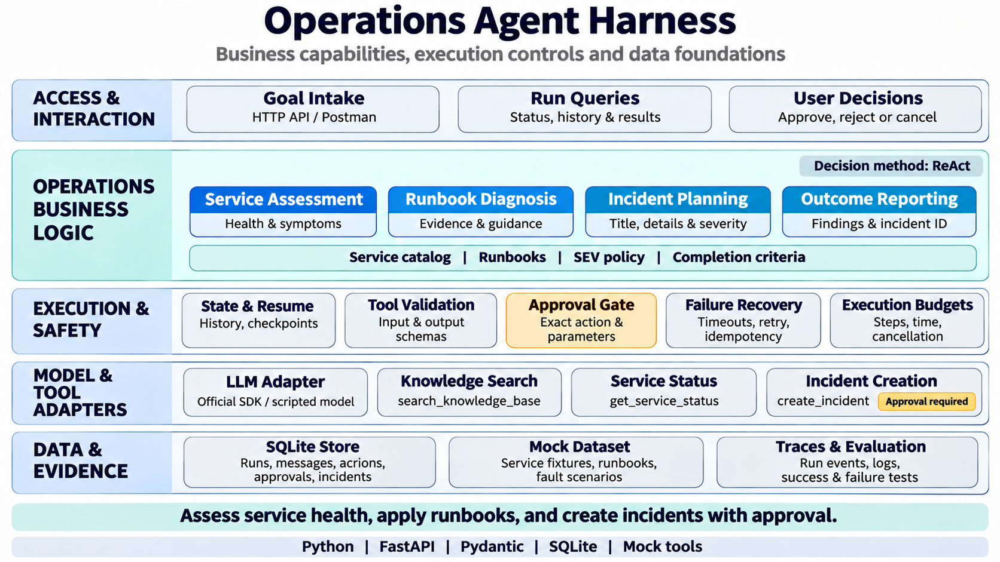
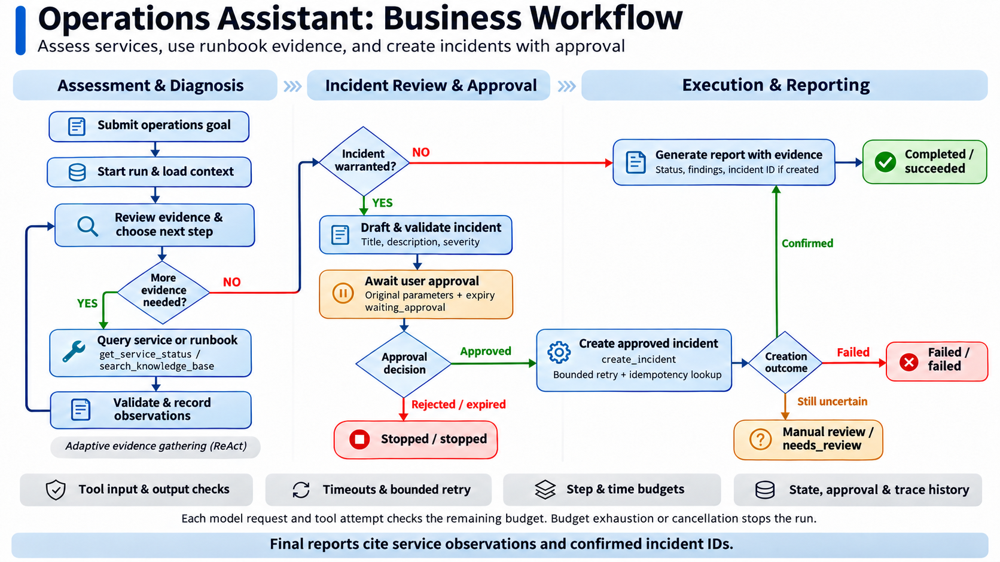
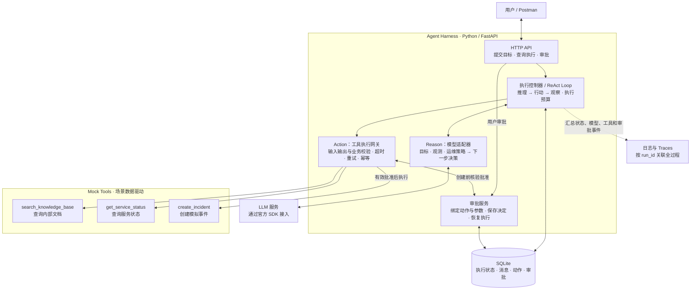
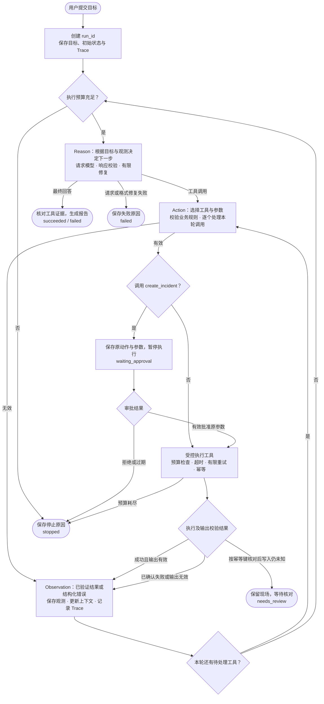

# 运维 Agent Harness：架构图与执行流程图

日期：2026-11-12  
设计路线：自写精简 Harness，使用官方模型 SDK；参考 Pi 的循环、工具契约和事件设计。

## 英文交付图

架构图采用五层堆叠结构，展示交互入口、运维业务逻辑、执行与安全、模型与工具适配、数据与证据。业务逻辑层突出服务评估、手册诊断、事件规划和结果报告，ReAct 作为决策机制注释。

流程图展示证据收集、事件必要性判断、用户审批、创建与核对、最终报告，以及失败和停止路径。

英文设计说明见 [Architecture and Business Workflow](./business-architecture-and-workflow-en.md)。ReAct 结合方法见 [补充说明](./react-business-design.md)。下方模块调用关系和控制流程用于实现契约设计。

## 1. 模块调用关系参考

模型负责提出下一步动作；Harness 管理执行、审批、校验和预算。用户通过 API 提交目标、审批动作并查询结果。

架构职责：

- 执行控制器：检查预算、推进状态、调用模型和工具、判断结束。
- 工具网关：验证输入输出，实施超时、有限重试和幂等控制。
- 审批服务：保存具体动作和参数，验证用户决定，通知控制器恢复原动作。
- 状态与观测：保存可恢复的执行历史，生成可按执行编号查询的 Trace。
- Mock Tools：从固定数据集中读取文档、服务状态和故障场景；创建事件写入模拟事件表。

## 2. 执行控制流程参考

流程规则：

1. 每次实际模型请求和工具尝试都检查剩余预算；重试和格式修复计入累计用量。
2. 等待审批时保存状态并释放执行资源；审批使用独立有效期，恢复后沿用原执行预算。
3. 批准绑定用户、run、动作、参数和有效期；批准后执行保存的原动作。参数变化生成新审批。
4. 同轮工具按顺序处理，审批暂停时保存处理游标；该轮结果回填完整后再请求模型。
5. 工具错误作为结构化反馈供模型判断下一步；持续失败最终由完成判定或预算限制结束执行。
6. 写入超时先按幂等键确认结果，确认成功则复用结果，无法确认则进入 needs_review。
7. 每次状态转换及模型、工具、审批活动都写入 Trace；持久化失败时停止推进写动作。

## 3. 实现思路

1. 先定义模型响应、工具输入输出、运行状态和事件契约。
2. 使用脚本模型与三个 Mock Tools 实现完整循环，验证审批、故障和限制路径。
3. 接入 SQLite 与 HTTP API，补齐审批恢复、重复提交和 Postman 演示。
4. 替换为真实模型适配器，完成端到端验证并整理测试证据。

详细方案见 [需求与概念设计](./requirements-and-concept-design.md)，实施任务见 [TODO](./TODO.md)。
