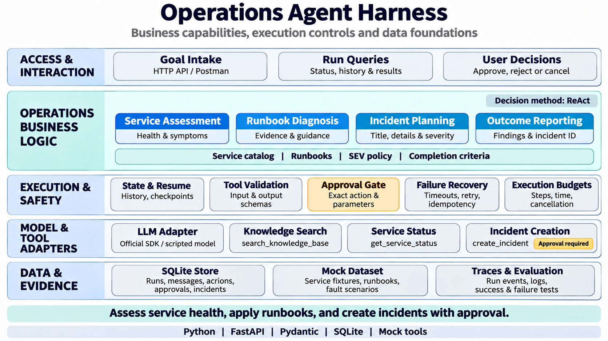
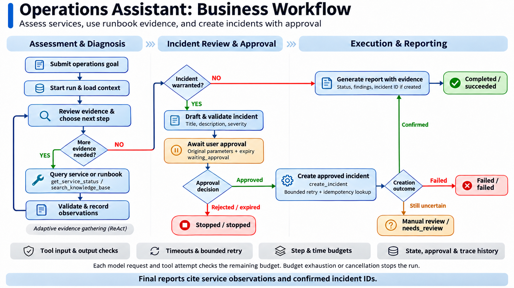

# Operations Agent Harness — Implementation Report

Date: 2026-11-12

## Objective and design

The assistant accepts an operations goal, gathers service and runbook evidence, proposes incident details, and creates an incident only after approval. A bounded execution harness owns state, validation, retry policy and trace history.

The implementation adopts Python 3.12, FastAPI and Pydantic from the supplied `agent_harness_ai.md` specification. This updates the earlier TypeScript concept. The layered business design is retained. Pi is an architectural reference; the project implements its own compact decision/action/observation loop.

| Layer | Implementation |
| --- | --- |
| Access & interaction | `main.py`, `src/api.py`: CLI, asynchronous run endpoints, authenticated queries and approvals |
| Operations business logic | `src/harness.py`, runbooks and service catalog: assessment, tool decisions, incident proposals and evidence checks |
| Execution & safety | `src/harness.py`, `src/schemas.py`: strict contracts, budgets, bounded retries, human approval and resumable actions |
| Model & tool adapters | `src/llm_client.py`, `src/tools.py`: injected provider, scripted model, official async SDK and three typed mock tools |
| Data & evidence | `src/storage.py`, `src/tracer.py`, `data/`, `tests/`: SQLite, JSONL events, synthetic dataset and deterministic tests |

## Business workflow

The model selects one action per turn from the registered tools. Observations contain validated outputs or structured errors. Runbooks provide handling and SEV guidance. User review authorizes the precise incident proposal. Final reports require service evidence where the objective requests a status check and confirmed IDs for incident-creation claims.

The `thought` contract is retained as a brief decision summary. ReAct supports decisions inside business assessment; the harness enforces execution policy.

## Database design

| Table | Keys and contents |
| --- | --- |
| `runs` | `session_id` primary key; owner, status, optimistic revision, JSON snapshot, execution claim and lease |
| `events` | `(session_id, sequence)` primary key and unique event ID; complete serialized step trace |
| `actions` | Logical action ID; run, tool, canonical parameter hash, arguments, attempt count and result |
| `approvals` | Approval ID; run/action/hash, pending/approved/rejected/expired status, expiry, authenticated decider and time |
| `incidents` | Incident ID and unique logical action/idempotency key; confirmed mock payload and creation time |
| `tool_counters` | `(session_id, tool_name)` primary key; persisted fault-injection attempt count |

Messages and the execution cursor are held in the run snapshot. SQLite transactions bind snapshots to events, bind approval decisions to the current action, and enforce unique incident writes. A single scheduler runs each claimed session; revisions reject stale transitions.

## Approval and recovery

API runs enter `AWAITING_APPROVAL` and release their execution claim. The approval record binds the run, logical action, canonical arguments, authenticated owner and expiry. Approval resumes the saved action. The CLI injects a callback that displays the complete draft before asking for an explicit decision.

Repeated identical decisions return the existing result. Conflicting decisions or altered hashes return 409. Unknown or foreign runs return 404. Rejection creates a `BLOCKED_BY_USER` observation without invoking the creation tool, and the model concludes with a cancellation summary.

An approved write rechecks current persisted approval inside the mock database transaction. Stable idempotency keys deduplicate equivalent creation proposals. A lost response is reconciled through the confirmed record. When reconciliation is unavailable, the session becomes `NEEDS_REVIEW` and preserves the pending action.

Approval waits survive application restart. Active budgets, model step count and tool attempts remain attached to the run. A graceful shutdown checkpoints interrupted work; restart scans resumable sessions. A crash with an outstanding execution claim waits for its bounded lease to expire before reassignment.

## Failures and execution limits

Defaults are 8 model requests, 30 active seconds, 16 tool attempts, a 15-second model timeout, a 3-second tool timeout, and at most 2 transient retries. Every actual request or attempt checks remaining budget; parse correction and retries consume their original counters. Approval waits pause active time and retain a 15-minute absolute expiry.

Pydantic validates model decisions and tool boundaries. Invalid tool arguments return field errors to the model. Invalid outputs are error observations and are not retried by the transient wrapper. Two consecutive malformed model responses end the run. Timeout and connection errors use bounded exponential backoff; permanent errors are returned directly.

An expiring total deadline is classified separately from a per-attempt timeout. This prevents a deadline-triggered cancellation from starting another tool retry. Cancellation propagates through asynchronous model and mock tool execution.

## Observability and tests

Each model request, decision, parse failure, tool attempt, retry, approval and transition records a `StepTrace`. Events include sequence, run/action IDs, timestamp, decision summary, validated input/output or error, retry count, duration and approval state. Events are committed to SQLite and flushed to redacted JSONL; exports can be rebuilt from the authoritative event table.

The suite covers the six required scenarios and additional API, identity, restart, idempotency, output-validation and cancellation cases. The real SDK is tested using its actual serialization against an in-process HTTP transport. Live model smoke verification is deferred for this delivery at the user's request. Measured results and completion status are in [validation-results.json](./validation-results.json).

Postman files include healthy, approved, rejected, retry, malformed response, permanent failure, execution-limit, incident-count and trace-export checks. The collection has bounded polling and uses the exact fetched approval hash.

## Submission materials

- Source and lockfiles, runnable CLI/API, and a clean-install README.
- Postman collection and environment template.
- Synthetic dataset, schemas, manifest and release archive.
- English architecture/workflow images, this report and sample JSONL traces.
- Source archive and checksums under `dist/`.

Current public links and live-model verification are recorded in [submission-checklist.md](./submission-checklist.md).

## Limitations and next steps

The environment uses mock services and a single application process. API identity defaults to one demo user. Scripted mode reproduces fixtures rather than interpreting arbitrary objectives. Real mode supports one validated JSON decision per model request.

Runbook rules and human review guide business severity decisions. Natural-language completion checks cover concrete unsupported creation claims and IDs; a structured result contract and domain evaluators would improve semantic assurance. Production adapters should add external reconciliation APIs, provider-specific cancellation and idempotency, enterprise identity and roles, PostgreSQL/queue coordination, and centralized telemetry.

## References

- [Supplied framework alignment](./framework-alignment.md).
- [OpenAI official Python SDK](https://developers.openai.com/api/reference/python): async client and retry configuration.
- [Chat Completions JSON output contract](https://developers.openai.com/api/reference/python/resources/chat/subresources/completions/methods/create).
- [ReAct paper](https://arxiv.org/abs/2210.03629) and [Pi agent core](https://github.com/earendil-works/pi/tree/main/packages/agent): conceptual references.
