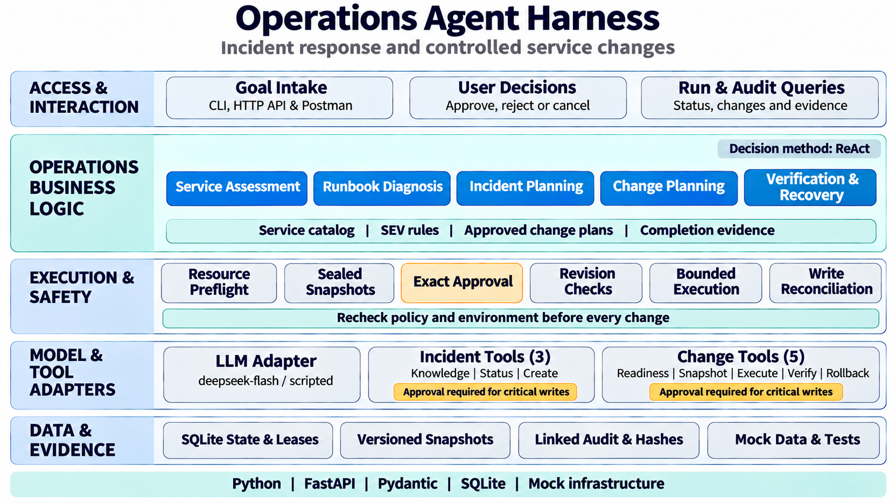
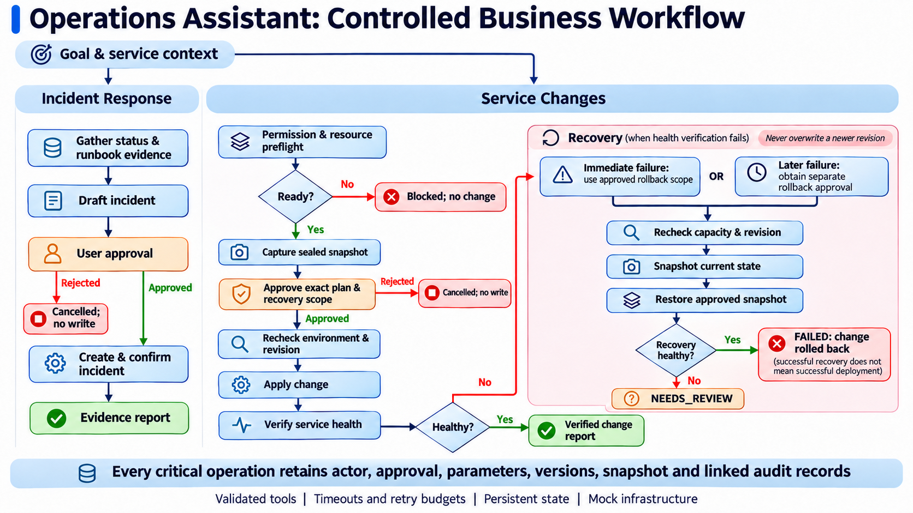

# Operations Agent Harness — Implementation Report

Updated: 2026-11-13 (Asia/Shanghai)

## Delivery and measured results

The implementation is available in the public [GitHub repository](https://github.com/wizounovziki/agent-harness-assessment). The tested live model is **DeepSeek `deepseek-flash`**, using **`https://api.deepseek.com/chat/completions`**. Every successful provider response also identified its model as `deepseek-flash`.

| Verification | Result | Evidence |
| --- | --- | --- |
| Automated regression | 96 passed; 0 failed, errors or skipped | [JUnit results](./examples/test-results.xml) |
| Postman API collection | 49 requests; 86 assertions passed | [Collection](../postman_collection.json), [validation summary](./validation-results.json) |
| Original incident model evaluation | 6/6 expected outcomes; 16 actual model requests | [Original results](./live-model-results.json) |
| Live change safety evaluation | 4/4 expected outcomes; 18 actual model requests | [Change results](./live-change-results.json) |
| Source archive installation | 96 tests passed after a fresh installation | [Validation summary](./validation-results.json) |
| Credentials | Exact runtime credential scan passed for deliverable files and ZIP entries | [Credential handling](#credential-handling) |

Live evaluation ran on 2026-11-12, 15:10:47–15:11:12 UTC, taking 24.984 seconds for all six cases. Provider-reported usage was 10,246 prompt tokens and 1,331 completion tokens, totaling 11,577 tokens. These are measured results from one execution of each case.

The request profile uses JSON output, disabled thinking, temperature 0 and a 2,048-token output cap. SDK automatic retries are disabled. The live evaluation allows 90 active seconds and a 30-second model timeout per case, with the default 8 model requests, 16 tool attempts and 2 transient retries. The explicit step-limit case allows one model request. Application defaults remain 30 active seconds and a 15-second model timeout.

| Live case | Expected / observed outcome | Model requests | Tool attempts | Incidents | Time (s) |
| --- | --- | --- | --- | --- | --- |
| Healthy auth service | `COMPLETED`, verified HEALTHY observation | 2 | 1 | 0 | 4.360 |
| Approved payment incident | `COMPLETED`, runbook evidence, SEV1 and confirmed incident ID | 4 | 3 | 1 | 6.203 |
| Rejected incident | `COMPLETED / user_rejected`, no creation | 4 | 2 | 0 | 5.579 |
| Transient tool timeout | `COMPLETED`, second tool attempt succeeded | 2 | 2 | 0 | 3.046 |
| Persistent tool connection failures | `FAILED / completion_evidence_missing` | 3 | 6 | 0 | 4.625 |
| One-request budget | `LIMIT_EXCEEDED / step_limit` | 1 | 1 | 0 | 1.125 |

Both approval cases paused in `AWAITING_APPROVAL` with zero incident records and zero creation-tool attempts. An independent test controller then submitted the predetermined approve/reject decision against the exact persisted draft. This exercises the approval boundary. The CLI displays the draft for user confirmation; the API waits for the authenticated user's decision. All live tests use mock operational tools and create no external incident.

Sanitized live traces are linked from [live-model-results.json](./live-model-results.json). Invalid model JSON, invalid tool output, time limits, cancellation, restart and duplicate approvals are covered by deterministic regression tests.

## Objective and design

The assistant handles incident response and controlled service changes. It gathers evidence, plans an incident or service operation, checks prerequisites, captures service state, obtains exact approval, and verifies the result. The bounded harness owns execution, persistent state, recovery policy and trace history.



The implementation adopts Python 3.12, FastAPI and Pydantic from the supplied `agent_harness_ai.md` specification. This updates the earlier TypeScript concept. The layered business design is retained. Pi is an architectural reference; the project implements its own compact decision/action/observation loop.

| Layer | Implementation |
| --- | --- |
| Access & interaction | `main.py`, `src/api.py`: CLI, asynchronous run endpoints, authenticated queries and approvals |
| Operations business logic | `src/harness.py`, runbooks and service catalog: assessment, incident/change plans, health verification, recovery and evidence checks |
| Execution & safety | `src/harness.py`, `src/schemas.py`: strict contracts, budgets, bounded retries, human approval and resumable actions |
| Model & tool adapters | `src/llm_client.py`, `src/tools.py`: injected provider, scripted model, official async SDK and eight typed mock tools |
| Data & evidence | `src/storage.py`, `src/tracer.py`, `data/`, `tests/`: SQLite, JSONL events, synthetic dataset and deterministic tests |

## Project tree and module guide

```text
agent-harness-assessment/
├── main.py                         # CLI: run, resume, show, export, serve
├── src/
│   ├── api.py                      # FastAPI routes, identity and request limits
│   ├── config.py                   # Environment configuration; hidden credential fields
│   ├── schemas.py                  # Model, state, approval and trace contracts
│   ├── change_schemas.py           # Workload, preflight, snapshot and rollback contracts
│   ├── operations.py               # Mock change control, resource checks and audit ledger
│   ├── harness.py                  # Decision/action/observation loop and execution policy
│   ├── llm_client.py               # Scripted, generic SDK and DeepSeek adapters
│   ├── tools.py                    # Eight validated mocks and fault injection
│   ├── service.py                  # Scheduling, persisted approvals and recovery
│   ├── storage.py                  # SQLite snapshots, events and transactional writes
│   ├── tracer.py                   # Redacted JSONL tracing and export reconstruction
│   └── errors.py                   # Typed model, tool, persistence and conflict errors
├── data/
│   ├── mock_services.json          # Three synthetic service records
│   ├── mock_kb_docs.json           # Four synthetic knowledge documents
│   ├── scenarios.json              # Twenty-one scripts and fault configurations
│   ├── mock_deployments.json       # Environment quotas, policies and artifacts
│   ├── schemas/                    # Eight exported JSON Schemas
│   ├── DATASET.md                  # Field guide and expected scenario behavior
│   └── manifest.json               # Dataset version, counts and SHA-256 hashes
├── tests/
│   ├── conftest.py                 # Isolated stores and injected model/tool fixtures
│   ├── test_happy_path.py          # Successful goals and evidence validation
│   ├── test_resilience.py          # Failures, retries, malformed JSON and recovery
│   ├── test_safety.py              # Approval, limits, cancellation and write safety
│   ├── test_api.py                 # Authentication, state, restart and HTTP behavior
│   ├── test_llm_client.py          # Actual SDK serialization and DeepSeek profile
│   ├── test_operations.py          # Preflight, snapshots, change/rollback and audit safety
│   └── test_delivery.py            # CLI, persistence and trace durability
├── scripts/
│   ├── build_mock_dataset.py       # Rebuild fixture scenarios and schemas
│   ├── build_postman.py            # Generate deterministic API collection
│   ├── export_openapi.py           # Export the running application's API contract
│   ├── live_model_evaluation.py    # Six paid incident cases and credential scanning
│   ├── live_change_evaluation.py   # Four paid service-change workflows
│   ├── live_model_smoke.py         # Optional single healthy-service live check
│   ├── prepare_submission.py       # Examples, measured summary and release ZIPs
│   └── verify_archives.py          # Archive contents and checksum checks
├── docs/
│   ├── implementation-report.md    # This report
│   ├── api-reference.md            # Endpoint collection and approval protocol
│   ├── openapi.json                # Machine-readable API contract
│   ├── live-model-results.json     # Original live incident results
│   ├── live-change-results.json    # Additional live change-control results
│   ├── operations-safety.md        # Added controls, contracts and recovery policy
│   ├── validation-results.json     # Regression, Postman and installation evidence
│   ├── images/                     # English architecture and business workflow
│   └── examples/                   # Scripted/live traces and JUnit results
├── postman_collection.json         # Ten folders, 49 requests, 86 assertions
├── postman_environment.json        # Local demo environment; no provider credentials
├── .env.example                    # Configuration names and empty credential fields
├── pyproject.toml                  # Dependencies and test/lint configuration
├── uv.lock                         # Reproducible dependency resolution
├── requirements.txt                # Alternative pip installation
└── README.md                       # Installation, execution and test commands
```

`runtime/` holds local SQLite databases, logs and temporary validation outputs. `dist/` holds generated source/dataset ZIPs and checksum files. Both are generated locally and excluded from Git. Empty Python package initializers and additional design notes are omitted from the tree for readability.

## Business workflow



The model selects one action per turn from the registered tools. Observations contain validated outputs or structured errors. Runbooks provide handling and SEV guidance. User review authorizes the precise incident proposal. Final reports require service evidence where the objective requests a status check and confirmed IDs for incident-creation claims.

The `thought` contract is retained as a brief decision summary. ReAct supports decisions inside business assessment; the harness enforces execution policy.

## Controlled change safety extension

The original implementation covered incident tools and run recovery. Service snapshots/rollback and deployment capacity checks were absent; existing traces did not include service-revision and recovery lineage. The design now treats controlled service change as a business capability in the five-layer architecture above.

The added sequence is **resource/environment/permission preflight → sealed service snapshot → exact approval → current-condition recheck → change execution → health verification**. Failed initial health may use the explicitly approved recovery scope. Later health failure requires a separate rollback approval, a fresh capacity/version check and a snapshot of the state being reverted. A newer revision prevents rollback; failed recovery requires NEEDS_REVIEW. Confirmed recovery preserves the original deployment's FAILED outcome.

The five added tools are `check_change_readiness`, `capture_change_snapshot`, `execute_service_change`, `verify_service_change` and `rollback_service_change`. Read their complete contracts, capacity formula, ownership and production boundaries in [operations-safety.md](./operations-safety.md). The [business concept](./business-architecture-and-workflow-en.md), [ReAct mapping](./react-business-design.md), architecture image and workflow image were updated together.

Four additional real `deepseek-flash` workflows passed: successful deployment (5 requests, 7.906 s), insufficient capacity (2 requests, 3.906 s), immediate failure and rollback (5 requests, 7.594 s), and later failure with separate rollback approval (6 requests, 10.031 s). Their 18 requests used 58,215 prompt tokens and 2,497 completion tokens: **60,712 total**. All tools remained mocked. Results and complete linked audit evidence are in [live-change-results.json](./live-change-results.json).

## Database design

| Table | Keys and contents |
| --- | --- |
| `runs` | `session_id` primary key; owner, status, optimistic revision, JSON snapshot, execution claim and lease |
| `events` | `(session_id, sequence)` primary key and unique event ID; complete serialized step trace |
| `actions` | Logical action ID; run, tool, canonical parameter hash, arguments, attempt count and result |
| `approvals` | Approval ID; run/action/hash, pending/approved/rejected/expired status, expiry, authenticated decider and time |
| `incidents` | Incident ID and unique logical action/idempotency key; confirmed mock payload and creation time |
| `tool_counters` | `(session_id, tool_name)` primary key; persisted fault-injection attempt count |
| `ops_resources`, `ops_environments` | Current manifests/configuration/revisions, capacity and trusted policy |
| `ops_objects` | Owned preflights, sealed snapshots, change records and reconciled write results |
| `ops_audit` | Transactional business events with trace/actor/approval/version links and a hash chain |

Messages and the execution cursor are held in the run snapshot. SQLite transactions bind snapshots to events, bind approval decisions to the current action, and enforce unique incident writes. A single scheduler runs each claimed session; revisions reject stale transitions.

## Approval and recovery

API runs enter `AWAITING_APPROVAL` and release their execution claim. The approval record binds the run, logical action, canonical arguments, authenticated owner and expiry. Approval resumes the saved action. The CLI injects a callback that displays the complete draft before asking for an explicit decision.

Repeated identical decisions return the existing result. Conflicting decisions or altered hashes return 409. Unknown or foreign runs return 404. Rejection creates a `BLOCKED_BY_USER` observation without invoking the creation tool, and the model concludes with a cancellation summary.

An approved write rechecks current persisted approval inside the mock database transaction. Stable idempotency keys deduplicate equivalent creation proposals. A lost response is reconciled through the confirmed record. When reconciliation is unavailable, the session becomes `NEEDS_REVIEW` and preserves the pending action.

Approval waits survive application restart. Active budgets, model step count and tool attempts remain attached to the run. A graceful shutdown checkpoints interrupted work; restart scans resumable sessions. A crash with an outstanding execution claim waits for its bounded lease to expire before reassignment.

## Failures and execution limits

Defaults are 8 model requests, 30 active seconds, 16 tool attempts, a 15-second model timeout, a 3-second tool timeout, and at most 2 transient retries. Every actual request or attempt checks remaining budget; parse correction and retries consume their original counters. Approval waits pause active time and retain a 15-minute absolute expiry.

Pydantic validates model decisions and tool boundaries. Invalid tool arguments return field errors to the model. Invalid outputs are error observations and are not retried by the transient wrapper. Two consecutive malformed model responses end the run. Timeout and connection errors use bounded exponential backoff; permanent errors are returned directly.

An expiring total deadline is classified separately from a per-attempt timeout. This prevents a deadline-triggered cancellation from starting another tool retry. Cancellation propagates through asynchronous model and mock tool execution.

## Observability and tests

Each model request, decision, parse failure, tool attempt, retry, approval and transition records a `StepTrace`. Events include sequence, run/action IDs, timestamp, decision summary, validated input/output or error, retry count, duration and approval state. Events are committed to SQLite and flushed to redacted JSONL; exports can be rebuilt from the authoritative event table.

The 96-test suite covers the six required scenarios and additional API, identity, restart, idempotency, output-validation and cancellation cases. The real SDK is tested using its actual serialization against an in-process HTTP transport, including DeepSeek-specific request fields and safe operational metrics. Live `deepseek-flash` results are recorded above and in [live-model-results.json](./live-model-results.json). Combined results are in [validation-results.json](./validation-results.json).

Postman files include healthy, approved, rejected, retry, malformed response, permanent failure, execution-limit, incident-count and trace-export checks. The collection has bounded polling and uses the exact fetched approval hash.

## API collection

Import [postman_collection.json](../postman_collection.json) and [postman_environment.json](../postman_environment.json). The [API reference](./api-reference.md) describes request bodies, response states, error codes and the approval sequence; [openapi.json](./openapi.json) contains the generated machine-readable contract. The local service also exposes `/docs` and `/openapi.json`.

| Method | Endpoint | Business purpose |
| --- | --- | --- |
| GET | `/health` | Public process health |
| GET | `/scenarios` | List available mock scenarios |
| POST | `/runs` | Submit a goal and receive the scheduled run |
| GET | `/runs/{session_id}` | Inspect state, budgets, proposal and final answer |
| GET | `/runs/{session_id}/events?after=0` | Read ordered trace events |
| GET | `/runs/{session_id}/incidents` | Inspect confirmed mock incidents |
| GET | `/runs/{session_id}/changes` | Inspect service changes and linked business audit |
| GET | `/runs/{session_id}/trace.jsonl` | Download the complete redacted trace |
| POST | `/runs/{session_id}/approvals/{approval_id}` | Approve or reject the exact incident proposal |
| POST | `/runs/{session_id}/cancel` | Stop active execution or pending approval |

Business endpoints use the server's `API_TOKEN`; `/health` is public. Run creation and approval return 202 and continue asynchronously. Postman uses only the local application token. The outbound DeepSeek interface is configured separately on the server.

## Mock Dataset

Dataset **v1.1.0** is distributed under MIT in the public [data directory](https://github.com/wizounovziki/agent-harness-assessment/tree/main/data), alongside its [field guide](../data/DATASET.md). It contains synthetic operations records and small, synthetic JSON and schema files. The manifest records counts and SHA-256 checksums for thirteen dataset files. Packaging also produces a standalone `dist/mock-dataset-v1.1.0.zip`.

| Component | Records / fields | Purpose |
| --- | --- | --- |
| Service catalog | 3: payment DOWN / 2,500 ms; auth HEALTHY / 42 ms; checkout DEGRADED / 850 ms | Verifiable status observations; fields: service name, status, latency and fixture timestamp |
| Knowledge base | 4 documents; `doc_id`, `title`, `content` | Service runbooks and SEV guidance for business decisions |
| Scenarios | 21 named envelopes with objective, description and model responses | Reproducible success, failure and safety evaluation |
| Fault controls | Per-tool sequences, delays, overrides and reconciliation behavior | Timeout, connection/permanent failures, invalid output and lost write responses |
| JSON Schemas | 8 exports: original contracts plus change plan, preflight, snapshot and change result | Inspectable contracts alongside Pydantic runtime validation |

The eight new change scenarios cover successful deployment, blocked capacity, immediate/later rollback, failed recovery, decommission, response loss and unknown write outcome. Trusted deployment data provides staging/production quotas, registered artifacts and configuration versions.

The original scenarios are `incident`, `healthy`, `retry`, `persistent_failure`, `malformed_json`, `malformed_forever`, `invalid_severity`, `loop`, `invalid_output`, `slow_tool`, `post_commit_timeout`, `unknown_write` and `prompt_injection`. The [dataset guide](../data/DATASET.md) maps each to its expected behavior.

Scripted mode consumes fixture model decisions. Live mode uses actual model decisions with the same service records, runbooks and configured tool faults; fixture model responses are unused. Fault counters persist across restart. Incident IDs and timestamps are generated at execution; the stable idempotency key prevents duplicate writes within a run. Fixture timestamps describe samples rather than live monitoring freshness.

## Credential handling

The provided provider credential was entered through a terminal prompt with echo disabled and used only in process memory. It was never written into a project configuration file, source, report, Postman collection or trace. Provider authentication is sent as an SDK request header and is excluded from model context and operational metrics. Metrics retain only request IDs, returned model names, timings, finish reasons and usage counts.

Before publication, the exact runtime credential is checked against deliverable files and every generated ZIP entry. The [scan receipt](./credential-scan.json) reports only file counts and success/failure. `.env.example` contains empty credential fields; `.env`, SQLite databases and runtime outputs are excluded from Git.

For local configuration, set `LLM_MODE=real`, `LLM_PROVIDER=deepseek`, `LLM_MODEL=deepseek-flash` and `DEEPSEEK_API_KEY` in the environment. `LLM_API_KEY` is an explicit override. `LLM_BASE_URL` defaults to `https://api.deepseek.com` for this provider. Application `API_TOKEN`, database/trace paths and execution-budget variables are listed in the [README configuration table](../README.md#configuration) and [.env.example](../.env.example).

## Submission materials

- Source and lockfiles, runnable CLI/API, and a clean-install README.
- Postman collection and environment template.
- Synthetic dataset, schemas, manifest and release archive.
- English architecture/workflow images, this report and sample JSONL traces.
- Source archive and checksums under `dist/`.

Current public links and live-model verification are recorded in [submission-checklist.md](./submission-checklist.md).

The complete project and dataset are published in the repository above. Anonymous access and installation verification are recorded in [publication.json](./publication.json).

## Limitations and next steps

The environment uses mock services, mock deployment resources and a single application process. Snapshot/restore controls cover registered stateless manifests and configuration; persistent volumes and database migrations need dedicated backup adapters. Recovery handles are scoped to the same run and operator. API identity defaults to one demo user. Scripted mode reproduces fixtures rather than interpreting arbitrary objectives. Real mode supports one validated JSON decision per model request.

Live evidence covers six original incident cases and four additional change cases, with one measured execution of each. It establishes integration behavior on this dataset; additional repetitions, service combinations and adversarial goals would support a broader reliability estimate. Model token usage is recorded without a currency-cost estimate. This version uses Chat Completions; a Responses adapter can share the existing provider interface.

Runbook rules and human review guide business severity decisions. Natural-language completion checks cover concrete unsupported creation claims and IDs; a structured result contract and domain evaluators would improve semantic assurance. Production adapters should add external reconciliation APIs, provider-specific cancellation and idempotency, enterprise identity and roles, PostgreSQL/queue coordination, and centralized telemetry.

## References

- [Supplied framework alignment](./framework-alignment.md).
- [OpenAI official Python SDK](https://developers.openai.com/api/reference/python): async client and retry configuration.
- [Chat Completions JSON output contract](https://developers.openai.com/api/reference/python/resources/chat/subresources/completions/methods/create).
- [DeepSeek Chat Completions API](https://api-docs.deepseek.com/zh-cn/api/create-chat-completion/): model name, JSON output and thinking controls.
- [ReAct paper](https://arxiv.org/abs/2210.03629) and [Pi agent core](https://github.com/earendil-works/pi/tree/main/packages/agent): conceptual references.
