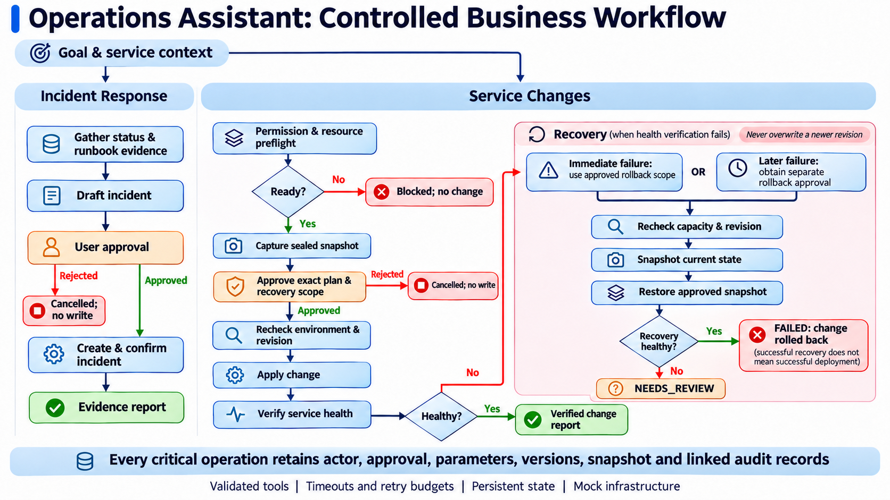
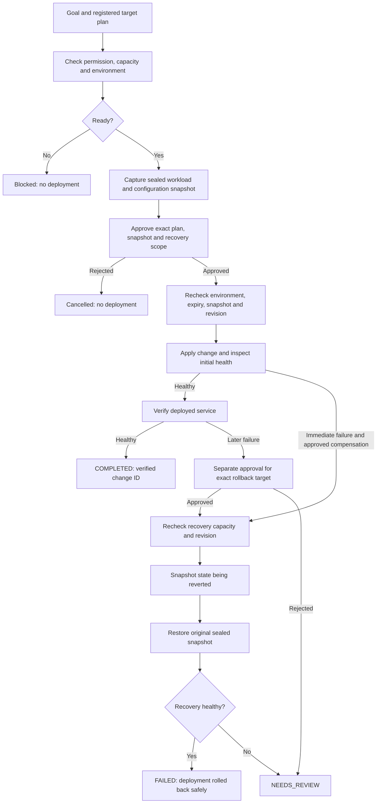

# Controlled Operations: Safety Design and Implementation

Updated: 2026-11-13 (Asia/Shanghai)

## Assessment of the proposed controls

| Requirement | Previous implementation | Current implementation |
| --- | --- | --- |
| Snapshot and rollback | Run snapshots and incident idempotency existed. Deployment/configuration snapshots and service rollback were absent. | Sealed service snapshots, registered immutable image digests, exact restoration targets, immediate compensation and separately approved later rollback. |
| Traceable critical operations | Model/tool events, run/action IDs, approval records and JSONL exports existed. Service revisions and deployment recovery lineage were absent. | Trace/span/parent IDs, trusted actor, parameter hash, approvals, preflight, snapshot, before/after revision, rollback evidence and a persisted audit hash chain. |
| Resource and environment preflight | Authentication, run ownership and schema validation existed. Deployment capacity and environment checks were absent. | Registered operator policy, CPU/memory and rollout surge estimates, snapshot capacity, runtime/dependency readiness, artifact/configuration validation, expiry and write-time revalidation. |

These controls address service changes with external effects. The model proposes a business action; the execution boundary verifies the evidence, authorization and current environment before applying it.

## Layered architecture


The business layer now contains two capabilities: incident response and controlled service changes. The original three tools remain available. Five additional tools connect to a transactional mock change-control adapter. The same persistent harness owns validation, approval, limits, failure handling and observation updates for both capabilities.

`src/change_schemas.py` defines versioned workload and change contracts. `src/operations.py` implements resource assessment, snapshots, deployment state, recovery and the business audit ledger. `src/tools.py` exposes these operations through the existing registry; trusted runtime context supplies the operator and run identity.

## Tool contracts

| Tool | Inputs and results | Side effects and execution rules |
| --- | --- | --- |
| `check_change_readiness` | Full `ChangePlan` -> preflight ID, READY/BLOCKED, check results, available/required resources, revision and expiry | Saves a bounded assessment. Checks trusted operator policy and registered artifacts/configurations. |
| `capture_change_snapshot` | Preflight ID -> snapshot ID, complete workload/configuration, source revision and checksum | Captures service state only after a successful fresh preflight. Does not alter the running workload. |
| `execute_service_change` | Full plan, preflight ID, snapshot ID, `rollback_on_failure` -> confirmed change ID, revision, health and outcome | Requires exact user approval. Rechecks policy, capacity, expiry, snapshot binding/integrity, target configuration checksum and current revision inside the write transaction. |
| `verify_service_change` | Change ID -> observed revision, health and outcome | Records the post-change assessment. An unverified/unhealthy change cannot produce a successful completion. |
| `rollback_service_change` | Change ID, reason, service/environment, exact restore manifest, snapshot ID and expected revision -> recovery outcome | Requires separate approval for later recovery. Rechecks capacity/authorization, snapshots the current state, restores the approved target and checks recovery health. |

`ChangePlan.operation` supports `deploy`, `update` and `decommission`. Decommission sets replicas to zero while retaining a restorable manifest and artifact reference. Plans use registered `sha256` image digests and configuration versions. Models cannot provide arbitrary shell commands, file paths, identities or privileges.

## Business workflow





Immediate compensation is authorized only when the exact approved execution arguments contain `rollback_on_failure=true`. With compensation disabled, an unhealthy deployment requires a separately approved rollback or operator review. A later unhealthy observation always uses a separate rollback proposal. Restoring a prior release succeeds as recovery while the original deployment goal remains failed.

## Preflight and snapshots

The mock environment exposes CPU millicores, memory MB, retained-snapshot slots, cluster/dependency readiness, operator capabilities and registered artifacts. Capacity accounts for other workloads and a conservative rollout peak. For each CPU/memory resource:

```text
peak = max(old_total + surge * new_per_replica,
           new_total + surge * old_per_replica)
required_extra = max(0, peak - old_total)
available = environment_quota - all_current_allocations
```

Decommission uses zero surge. Initial preflight reserves snapshot capacity for the original state and possible recovery. The execution recheck requires remaining recovery snapshot capacity. Rollback checks the resources needed to restore the saved replica count. A successful assessment expires after five minutes; refreshing it creates a new assessment and requires approval of its associated proposal.

Snapshots contain the image digest, configuration version and values/references, replica count, CPU/memory specification, service/environment, preflight binding and source revision. SHA-256 binds these fields. Image availability and retention are checked before changes and recovery. Snapshot identity and contents are persisted independently from the agent's run-state snapshot.

The implementation retains mock artifact references; it does not copy real container layers or container memory. A production adapter should enforce registry retention or copy required artifacts into an immutable repository. Stateful workloads need storage/database backups and migration-compatibility checks before automatic compensation. Kubernetes Deployment revisions restore the Pod template; configuration and other resources need their own recovery coverage. [Kubernetes deployment documentation](https://kubernetes.io/docs/concepts/workloads/controllers/deployment/).

Capacity checks use declared requests rather than observed idle CPU alone. This matches the scheduling distinction described in [Kubernetes resource management](https://kubernetes.io/docs/concepts/configuration/manage-resources-containers/). Production adapters should query allocatable capacity, quotas, scheduling constraints, storage, dependencies and server-side dry-run results, and reserve resources across execution.

## Persistence and audit

| Table | Contents |
| --- | --- |
| `ops_resources` | Current service/environment manifest, configuration, health and monotonic revision |
| `ops_environments` | Trusted environment capacity, readiness and operator policy |
| `ops_objects` | Owned preflight records, sealed snapshots, changes and idempotent write results |
| `ops_audit` | Ordered business events with trace/action/actor links and chained hashes |

Snapshot creation, workload mutation, write results and business audit entries share the same SQLite connection and transaction. If audit persistence fails, the mock workload mutation rolls back. Lost responses are reconciled by the original logical action ID; unavailable reconciliation enters `NEEDS_REVIEW`.

Each critical action records the trusted actor, action/trace/span identifiers, approval ID and parameter hash, target plan, snapshot, before/after revision and observed result. Automatic compensation links to the approved execution scope. A later rollback records its own approval and a snapshot of the state being reverted. Read the complete chain using `GET /runs/{session_id}/changes`; ordinary run events and JSONL traces remain available.

Hashes detect modified audit entries when the chain is read. External anchoring, retention policy, encryption and immutable storage remain production improvements; a local SQLite hash chain does not prevent privileged database replacement or truncation.

## Validation

The regression suite includes deployment success, capacity refusal, snapshot-before-write, exact approval/rejection, expired or corrupted evidence, changed resource capacity, revoked operator access, newer revisions, response loss, restart, decommission, failed rollback and audit persistence failure. A shared-environment regression verifies that later recovery restores the actual last good release.

The extended Postman collection has 10 folders, 49 requests and 86 assertions. It exercises approved deployment, initial failure compensation, insufficient capacity and separate later rollback approval, alongside the incident scenarios.

Live `deepseek-flash` evaluation passed four additional workflows: deployment success, capacity refusal, immediate failure recovery and later failure recovery. It made 18 model requests and used 60,712 provider-reported tokens (58,215 prompt; 2,497 completion). Exact settings, per-case outcomes, approval boundaries and audit events are in [live-change-results.json](./live-change-results.json). Original incident-model evidence remains in [live-model-results.json](./live-model-results.json).

## Run and review

```powershell
uv run pytest -q
uv run python main.py run "Deploy auth in staging and verify health." --scenario deploy_success
uv run python main.py run "Deploy auth with failure recovery." --scenario deploy_rollback
uv run python main.py run "Deploy auth and recover from a later health failure." --scenario deploy_late_failure
uv run python main.py serve
```

The deterministic scenarios contain the exact target plan. For real model mode, include the desired registered image digest, configuration version, replicas and resource specification in the goal. Paid model verification is available through `uv run python -m scripts.live_change_evaluation`, which reads the provider credential with terminal echo disabled.

The current recovery tools operate on changes owned by the same run and operator. Long-running external monitoring and cross-run recovery delegation require additional lifecycle and authorization policies. All infrastructure changes in this assessment remain mocked.
