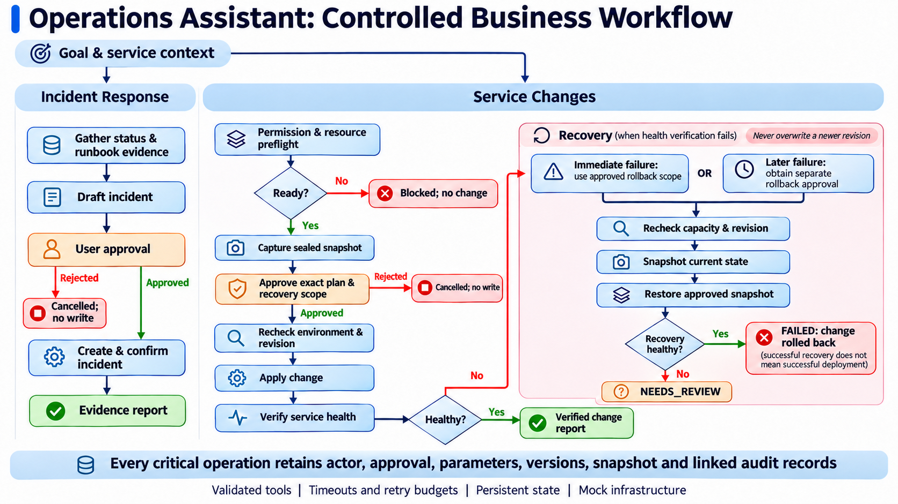

# 运维 Agent Harness：需求与概念设计

更新：2026-11-13。技术栈：Python 3.12、FastAPI、Pydantic、SQLite、pytest。当前方案包含故障响应和受控服务变更两条业务路径。

## 目标与边界

通过 CLI 或 HTTP API 接收运维目标，在模型与工具之间执行有限循环，保存状态与证据。故障路径支持查询、Runbook 判断与批准后建单；变更路径支持部署、更新、下线、验证和回退。基础设施均为 Mock。

模型仅提出单个动作及简短依据。可信运行时负责身份、工具参数、权限、快照、审批、资源和版本检查。Pi 为模块划分的概念参考，当前项目实现精简运行循环。

## 需求和验收

| 需求 | 执行约束 | 验收证据 |
| --- | --- | --- |
| 目标接入与模型循环 | 每轮一个 CALL_TOOL 或 FINAL_ANSWER | CLI/API、真实 DeepSeek 与确定性脚本 |
| 严格工具契约 | 输入/输出 Pydantic 校验，不可信文档作为数据 | 格式错误、非法参数、错误输出测试 |
| 状态与历史 | SQLite 保存游标、观测、审批、动作、计数与事件 | 重启恢复、冲突与日志重建测试 |
| 有限执行 | 步数、活跃时间、工具次数、单次超时、有限重试 | 步数/时间/取消与重试测试 |
| 关键写入批准 | 绑定具体动作、参数哈希、操作者与有效期 | 拒绝、过期、重复与越权测试 |
| 服务快照与恢复 | 配置、镜像摘要、副本、资源、源版本及校验值 | 缺失/损坏快照、回滚与恢复失败测试 |
| 环境与容量预检 | 权限、CPU/内存、滚动峰值、快照容量、依赖和制品 | 资源不足及审批后环境变化测试 |
| 可追溯业务链 | Trace/Span、操作者、批准、参数、快照与版本 | 审计链、事务失败与恢复证据 |
| 证据支持的结果 | 未验证变更不能成功；回滚不等于发版成功 | 完成证据与 NEEDS_REVIEW 测试 |

## 分层架构

| 层级 | 职责 |
| --- | --- |
| 接入与交互 | CLI、HTTP、Postman、查询、审批和取消 |
| 运维业务 | 服务评估、Runbook、事件与变更计划、验证及恢复 |
| 执行与安全 | 预检、服务快照、准确批准、版本、预算和副作用核对 |
| 模型与工具适配 | DeepSeek/脚本模型，3 个故障工具和 5 个变更工具 |
| 数据与证据 | 运行状态、环境/部署、快照、审计、Mock 数据与测试 |

ReAct 组织业务决策与反馈，权限和副作用控制由执行边界实施。

## 工具清单

| 工具 | 业务用途 | 批准要求 |
| --- | --- | --- |
| search_knowledge_base | 搜索 Runbook 与严重程度规则 | 无关键写入 |
| get_service_status | 查询服务样本状态 | 无关键写入 |
| create_incident | 创建模拟故障事件 | 用户批准原参数 |
| check_change_readiness | 注册目标计划的权限/环境/容量测算 | 保存预检记录 |
| capture_change_snapshot | 保存清单、配置、镜像引用与源版本 | 需要有效预检 |
| execute_service_change | 部署、更新或下线 | 用户批准完整计划、快照及恢复范围 |
| verify_service_change | 记录运行状态与健康验证 | 保存验证结果 |
| rollback_service_change | 恢复已记录变更的目标快照 | 独立批准具体恢复清单与预期版本 |

## 业务流程

故障：状态与 Runbook 证据 → 草案 → 批准 → 受控建单 → 编号核对与报告。

变更：明确计划 → 权限/容量/环境预检 → 服务快照 → 批准 → 再次校验前置条件 → 变更 → 健康验证 → 报告。

初次验证失败时，仅在批准的 rollback_on_failure=true 范围内自动补偿。后续健康失败时，独立审批恢复对象；再检查资源和版本，保存回退前现场，恢复原快照并验证。存在较新版本时拒绝覆盖。

## 状态与完成条件

| 状态 | 业务含义 |
| --- | --- |
| RUNNING | 模型决策或工具执行 |
| AWAITING_APPROVAL | 原参数已保存，等待明确决定 |
| COMPLETED | 目标有已验证证据，或用户拒绝后的取消总结 |
| FAILED | 目标未完成；包括预检阻止或部署失败后成功恢复 |
| LIMIT_EXCEEDED | 运行预算达到上限且无未解决变更 |
| STOPPED | 取消或审批过期 |
| NEEDS_REVIEW | 写入不明、变更未验证/不健康或恢复失败 |

审批等待不消耗活跃执行预算。模型与工具的实际调用计数跨审批和重启保留。预算停止或取消后，如已有未解决变更，保存待人工复核状态。

## 数据与一致性

原有 runs、events、actions、approvals、incidents、tool_counters 保存执行与故障记录。新增：

- ops_resources：当前服务清单、配置、健康与版本。
- ops_environments：可信容量、依赖状态、操作者和操作策略。
- ops_objects：归属明确的预检、服务快照、变更与幂等结果。
- ops_audit：可关联的业务事件与哈希链。

Mock 资源修改、快照、结果和业务审计共用事务；审计写入失败时不提交资源变更。响应丢失先查原动作结果，无法确认时进入 NEEDS_REVIEW。

## 预检与安全策略

预检包含容量及滚动峰值、快照余量、集群与依赖状态、配置版本、镜像保留与验证、操作者授权。结果有效期五分钟。执行与恢复均重新检查权限、资源和当前版本。

快照以 SHA-256 绑定服务、环境、预检、清单、配置和源版本。镜像使用不可变摘要。当前 Mock 保存制品引用，真实适配需要落实镜像保留/复制、配置加密及持久卷备份。

Trace 使用 run/trace/action/span/parent 标识，并关联操作者、批准、参数哈希、前后版本与快照。业务审计哈希链可检查记录修改，生产留存仍需外部不可变存储。

## API 与交付

原有执行、审批、取消、事件、故障与 Trace 接口保留；新增 GET /runs/{session_id}/changes 查询归属受控的变更和审计链。完整契约见 [接口合集](./api-reference.md) 与 [OpenAPI](./openapi.json)。

验收包括 96 个自动化测试、49 次 Postman 请求/86 项断言、原有 6 个真实模型案例及新增 4 个变更案例。模型为 deepseek-flash，配置及用量分别记录于两个 live results 文件，实际凭据不进入交付材料。

数据集 v1.1.0 包括 3 个服务、4 份 Runbook/规则文档、2 个部署环境、21 个场景和 8 份 JSON Schema。代码与数据提交到 [指定仓库](https://github.com/wizounovziki/agent-harness-assessment)。

## 实施待办与后续方向

当前待办与验证状态见 [TODO](./TODO.md)、[报告](./implementation-report.md) 和 [变更安全设计](./operations-safety.md)。

生产接入需要真实监控/流水线/镜像库/备份适配器、企业身份与职责分离、资源预留及跨进程协调、持续健康监控、状态数据迁移保护、审计留存策略，以及跨执行回退授权。当前恢复句柄限定于同一执行和操作者。
